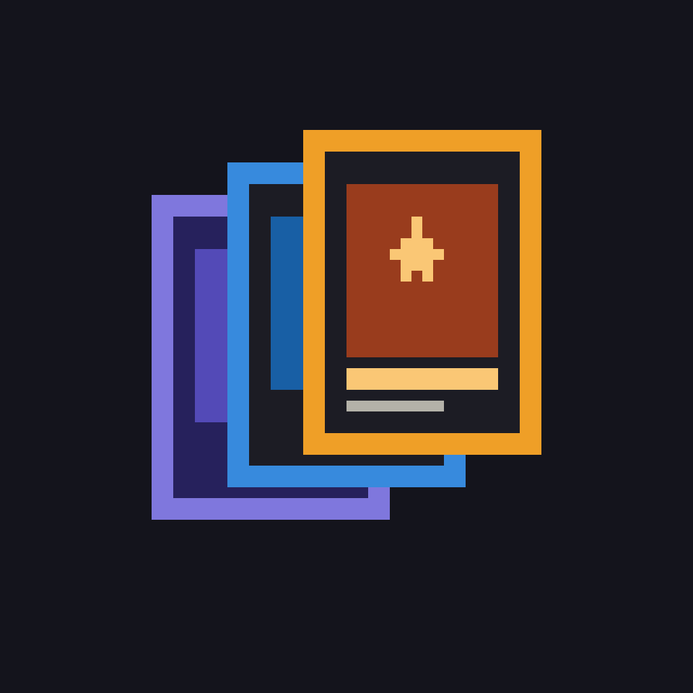
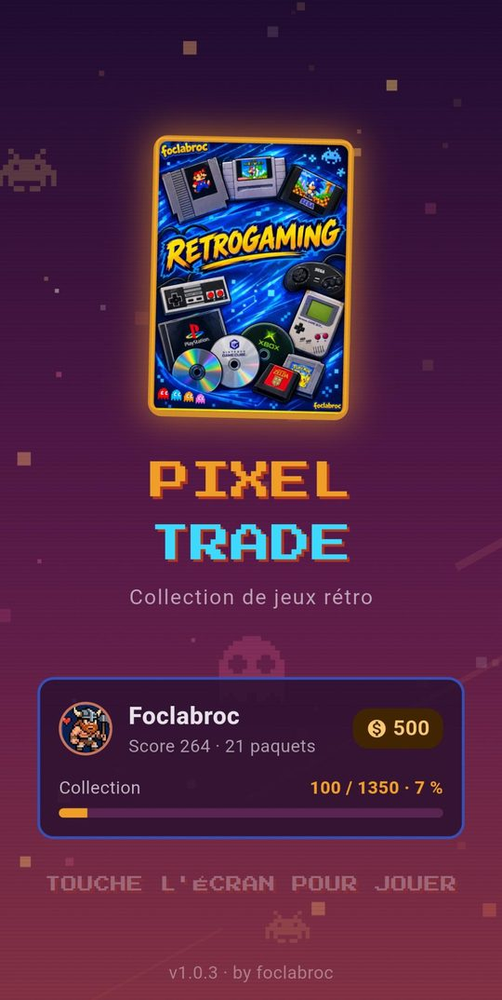
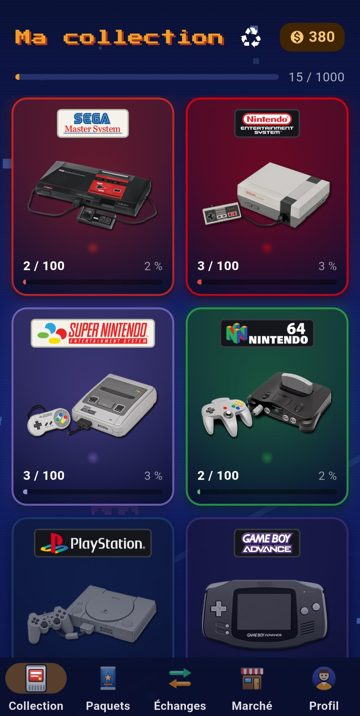
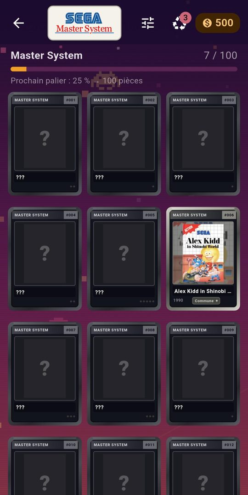
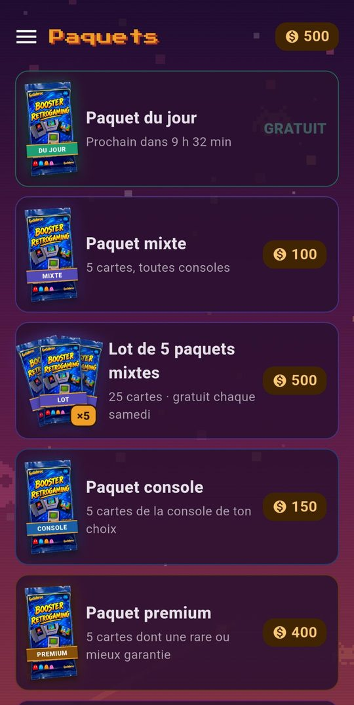
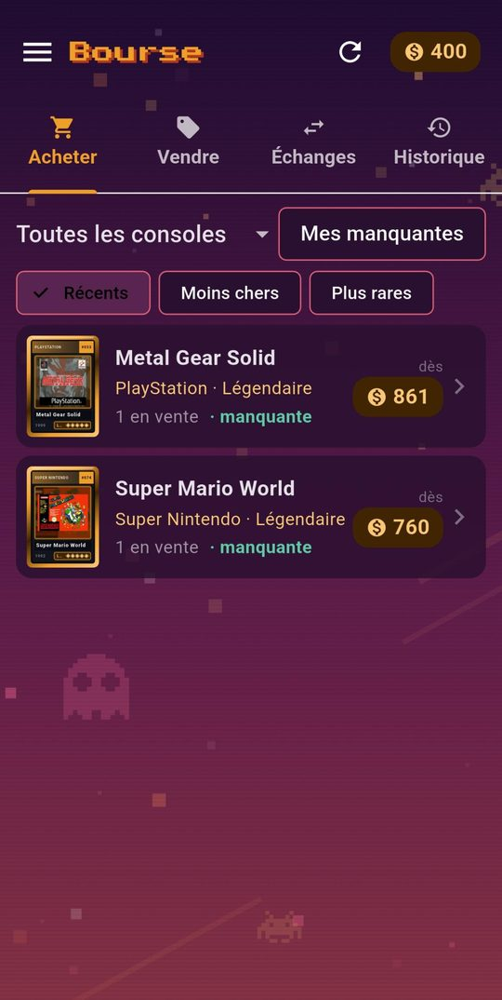
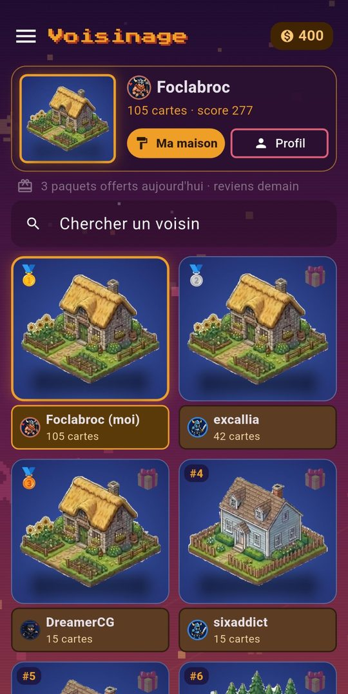

<p align="center">
  
</p>

<h1 align="center">Pixel Trade</h1>

<p align="center">
  <b>Le jeu de cartes à collectionner du retrogaming</b><br>
  Ouvre des boosters, complète tes séries de jaquettes rétro et échange avec les autres joueurs.<br>
  <i>by foclabroc</i>
</p>

<p align="center">
  <a href="https://github.com/foclabroc/retro_collec_app/releases/latest"><b>⬇️ Télécharger le dernier APK</b></a>
  &nbsp;·&nbsp;
  <a href="https://foclabroc.github.io/retro_collec_app/"><b>🌐 Jouer dans le navigateur</b></a>
</p>

---

<p align="center">
  
  
  
</p>
<p align="center">
  
  
  
</p>

> **Nouveau en v1.0.3** : 4 consoles (PSP, Game Gear, GameCube, PS2), la Bourse, le Voisinage en maisons,
> la fusion, les notifications Android, les thèmes… et **800 pièces offertes** à tous les joueurs !
> Détails dans le [CHANGELOG](CHANGELOG.md).

## 🎮 Le jeu

**2300 cartes** de jaquettes de jeux, réparties en **29 séries** (100 cartes, 50 pour la PS2, la 3DS, la SG-1000, la Dreamcast, l'Atari 7800, l'Amiga CD32, la Lynx, la Supervision, la ColecoVision, la Saturn, la Wii U et la Xbox), plus **8 sagas** en cartes holo (Mario, Sonic, Zelda, Pokémon, Resident Evil, Castlevania, Kirby, Street Fighter) :

| Sega | Nintendo | Autres |
|---|---|---|
| SG-1000 · Master System | NES · Super Nintendo · Nintendo 64 · GameCube | PlayStation · PS2 · PSP · Xbox |
| Mega Drive · Game Gear · Saturn · Dreamcast | Game Boy · Game Boy Color · Game Boy Advance · 3DS | Neo Geo · Atari 2600 · Atari 7800 · Lynx |
| | Wii · Wii U · Switch | ColecoVision · Amiga 1200 · Amiga CD32 · Supervision |

Chaque carte a une **rareté** (commune, peu commune, rare, épique, légendaire) et une **finition** (normale, brillante, dorée). Sa fiche donne la capture d'écran, l'année, le développeur, l'éditeur, le genre et la description du jeu.

### Fonctionnalités

**Boosters et collection**
- 🎁 **Boosters** : paquet gratuit chaque jour, mixte, console (au choix), premium (rare garantie), mystère (3, 5 ou 8 cartes). Une épique ou mieux est garantie au plus tard au 30e paquet.
- 📦 **Lot de 5 paquets mixtes** (500 pièces), **gratuit chaque samedi**.
- ✨ **Ouverture animée** : fais tourner le booster au doigt comme une carte, déchire-le le long du pointillé, suspense selon la rareté, effets pour les épiques et légendaires.
- 📚 **Ma collection** : tableau de bord (progression, raretés, doublons, brillantes, dernières cartes) et consoles en **posters rétro** ; un album par console avec récompenses à 25, 50, 75 et 100 %.
- 🔍 **Filtres, tri et recherche** : possédées, manquantes, doublons, finition, rareté, genre ; recherche dans toutes ses cartes.
- ♻️ **Recyclage et fabrication** : les doublons rapportent des pièces pour fabriquer la carte qui te manque.
- ⚗️ **Fusion** : 5 normales → 1 brillante, 3 brillantes → 1 dorée.

**Entre joueurs**
- 📈 **Bourse** : marché groupé par carte (prix le plus bas, tri), ventes, échanges jusqu'à 5 cartes contre 5, historique. Chaque fiche de carte propose Acheter / Vendre / Échanger.
- 🏠 **Voisinage** : une parcelle et une **maison** par joueur (12 au choix, certaines débloquées par la collection), classement, profils et albums des voisins.
- 🎀 **Cadeaux** : offre jusqu'à 3 paquets par jour ; les paquets reçus s'ouvrent depuis « Cadeaux reçus » avec la liste des donateurs.
- 💬 **Messages** : chat entre joueurs, mentions @pseudo, filtre et signalement.
- 🏆 **Profils publics** : vitrine de tes plus belles cartes, statistiques, collection visible.

**Bonus et confort**
- 🎡 **Bonus** : roue de la fortune quotidienne (roue en or tous les 7 jours d'affilée), **Gamedle** (le jeu du jour) et quiz rétro.
- 📰 **Actualités** : les exploits des joueurs (légendaires, dorées, séries complétées).
- 📅 **Missions du jour** et bonus de connexion.
- 🔔 **Notifications Android**, même appli fermée : cadeau reçu, carte vendue, échange proposé, mention, paquet gratuit.
- 🎨 **Personnalisation** : 5 thèmes d'interface, 18 avatars pixel art, 8 musiques chiptune.
- ☰ **Menu latéral** accessible depuis n'importe quel écran (glisser depuis le bord gauche).
- 📱 **Mode tablette** : sur tablette en paysage et sur PC, menu toujours visible, plus de colonnes, fiche et offres affichées à côté.
- 🔐 **Compte** : pseudo + mot de passe ou code de sauvegarde pour retrouver ton profil sur un autre téléphone.
- 🌍 **Français / English** : automatique selon le téléphone, ou au choix dans les réglages.
- ⬆️ **Mises à jour** : l'appli prévient quand une nouvelle version est disponible et l'installe ; écran « Nouveautés » à chaque version.

## 📲 Installation

1. Télécharge le fichier `retro.collec.Vx.y.z.apk` depuis la [dernière release](https://github.com/foclabroc/retro_collec_app/releases/latest).
2. Ouvre-le sur ton téléphone Android et autorise l'installation d'applis inconnues si Android le demande.
3. Au premier lancement, les cartes sont téléchargées une fois (environ 90 Mo), puis l'appli choisit ton pseudo et ton avatar.

**Version web** : [foclabroc.github.io/retro_collec_app](https://foclabroc.github.io/retro_collec_app/), sur PC, Mac, iPhone ou tablette, sans rien installer (« Ajouter à l'écran d'accueil » pour l'avoir comme une appli). Pour retrouver ton profil Android, connecte-toi avec ton pseudo + mot de passe ou ton code de sauvegarde. Pas de notifications ni d'effets sonores sur le web (la musique, elle, marche partout, iPhone compris).

Une connexion Internet est nécessaire pour jouer : toute la partie (pièces, tirages, collection) est gérée par le serveur.

## 🛠️ Architecture

```
Batocera (scrapes)  ──►  retro_collec_export.py  ──►  GitHub Pages (retro_collec_assets)
                                                        catalog.json + packs de jaquettes
                                                                │
Appli Flutter (ce dépôt)  ◄─────────────────────────────────────┘
        │
        └──►  Supabase (tables rc_*, fonctions SQL signées) : joueurs, collection,
              tirages, bourse, cadeaux, messages, classement
```

- **Appli** : Flutter (Android), police Press Start 2P, musique et effets sonores natifs.
- **Images** : jaquettes et captures en WebP, hébergées sur [foclabroc/retro_collec_assets](https://github.com/foclabroc/retro_collec_assets) et gardées en cache sur le téléphone.
- **Serveur** : Supabase. Tout est décidé côté serveur (pièces, tirages, raretés), l'appli appelle des fonctions SQL signées.

### Fichiers principaux (`lib/`)

| Fichier | Rôle |
|---|---|
| `main.dart` | Démarrage, écran titre, navigation par onglets |
| `welcome.dart`, `account.dart` | Premier lancement, connexion, mot de passe |
| `game.dart` | État du joueur, langue, textes communs |
| `server.dart` | Appels au serveur Supabase |
| `catalog.dart` | Catalogue des cartes (téléchargement, cache, mises à jour) |
| `cards.dart` | Rendu des cartes, gyroscope, dos de carte |
| `library.dart`, `album.dart` | Collection par console, album, fiche d'une carte |
| `packs.dart` | Boutique, confirmation d'achat, ouverture des boosters |
| `bourse.dart`, `market.dart`, `trades.dart` | Bourse : marché, ventes, échanges, historique |
| `neighbors.dart`, `house.dart`, `profile.dart` | Voisinage, maisons, profils et réglages |
| `chat.dart`, `notifs.dart`, `push.dart` | Messages, pastilles, notifications Android |
| `filters.dart`, `retro_theme.dart`, `whats_new.dart` | Filtres et tri, thèmes, écran Nouveautés |
| `update_check.dart` | Vérification et installation des mises à jour |

## 🧑‍💻 Compiler

```bash
flutter pub get
dart run flutter_launcher_icons   # seulement si l'icône change
flutter run --release              # téléphone branché
flutter build apk --release        # APK dans build/app/outputs/flutter-apk/
flutter run -d chrome              # version web en local
flutter build web --release --base-href /retro_collec_app/   # version web dans build/web/
```

### Publier une nouvelle version

1. Changer `kRetroCollecVersion` dans `lib/update_check.dart` **et** `version:` dans `pubspec.yaml`.
2. Mettre à jour la liste `_kNews` dans `lib/whats_new.dart` (écran Nouveautés) et le `CHANGELOG.md`.
3. Si besoin, lancer le patch SQL de la version dans Supabase (ex. `patch_v103.sql`).
4. `flutter build apk --release`
5. Renommer l'APK en `retro.collec.V<version>.apk` (ex. `retro.collec.V1.0.3.apk`).
6. Créer une release GitHub `v<version>` sur ce dépôt et y joindre l'APK.

Les joueurs sont prévenus au lancement suivant. Toujours signer avec la même clé (même PC), sinon la mise à jour ne s'installe pas par-dessus.

### Version web

Publiée automatiquement par GitHub Actions (`.github/workflows/web.yml`) à chaque push sur `main`, sur [foclabroc.github.io/retro_collec_app](https://foclabroc.github.io/retro_collec_app/). Les jaquettes sont lues directement sur `retro_collec_assets` (rien à télécharger d'avance).

### Mettre à jour les cartes

Sur la Batocera :

```bash
python3 /userdata/retro_collec_export.py --rebuild
```

Puis pousser `/userdata/retro_collec` sur le dépôt `retro_collec_assets` et coller `catalog.sql` dans Supabase. Les textes se corrigent dans `csv/<console>.csv` (colonnes `desc_en` / `genre_en` pour l'anglais). L'appli récupère le nouveau catalogue au lancement suivant.

---

<p align="center">Projet perso de fan de retrogaming · les jaquettes et noms de jeux appartiennent à leurs éditeurs respectifs.</p>
