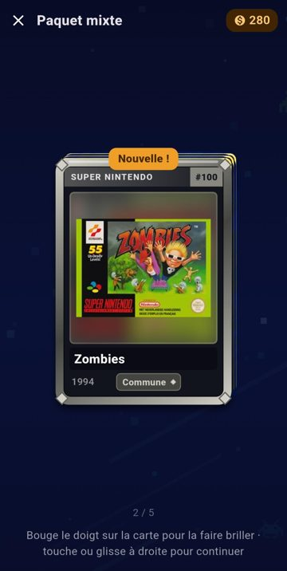
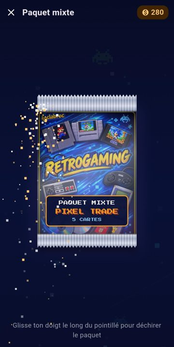
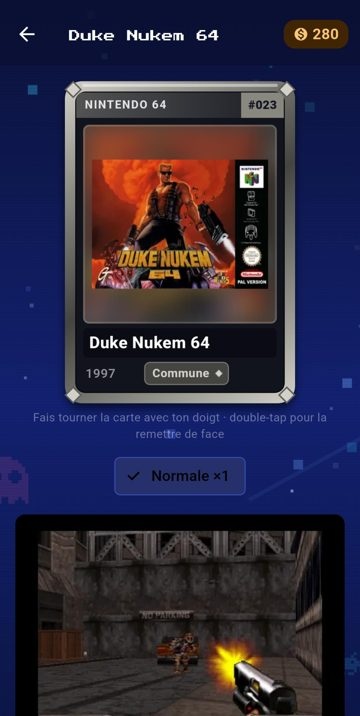

<p align="center">
  
</p>

<h1 align="center">Pixel Trade</h1>

<p align="center">
  <b>Le jeu de cartes à collectionner du retrogaming</b><br>
  Ouvre des boosters, complète tes séries de jaquettes rétro et échange avec les autres joueurs.<br>
  <i>by foclabroc</i>
</p>

<p align="center">
  <a href="https://github.com/foclabroc/retro_collec_app/releases/latest"><b>⬇️ Télécharger le dernier APK</b></a>
</p>

---

<p align="center">
  
  
  
</p>
<p align="center">
  
  
  
</p>

## 🎮 Le jeu

**1000 cartes** de jaquettes de jeux, réparties en **10 séries de 100** :

| Sega | Nintendo | Autres |
|---|---|---|
| Master System | NES · Super Nintendo · Nintendo 64 | PlayStation |
| Mega Drive | Game Boy Color · Game Boy Advance · Switch | Neo Geo |

Chaque carte a une **rareté** (commune, peu commune, rare, épique, légendaire) et une **finition** (normale, brillante, dorée). Sa fiche donne la capture d'écran, l'année, le développeur, l'éditeur, le genre et la description du jeu.

### Fonctionnalités

- 🎁 **Boosters** : paquet gratuit chaque jour, paquet mixte, paquet console (au choix), paquet premium (rare garantie). Une épique ou mieux est garantie au plus tard au 30e paquet.
- ✨ **Ouverture animée** : on déchire le paquet du doigt, suspense selon la rareté, effets spéciaux pour les épiques et légendaires, reflet holographique au gyroscope.
- 📚 **Collection** : un album par console, avec la progression et des récompenses à 25, 50, 75 et 100 %.
- ♻️ **Recyclage et fabrication** : les doublons rapportent des pièces, qui servent à fabriquer la carte qui te manque.
- 🛒 **Marché** : mets tes cartes en vente ou achète celles des autres joueurs.
- 🔄 **Échanges** : propose jusqu'à 5 cartes contre 5 à n'importe quel joueur.
- 🏆 **Profils publics** : vitrine de tes plus belles cartes, collection visible, classement.
- 📅 **Missions du jour** et bonus de connexion.
- 🔐 **Compte** : pseudo + mot de passe ou code de sauvegarde pour retrouver ton profil sur un autre téléphone.
- 🌍 **Français / English** : automatique selon le téléphone, ou au choix dans les réglages.
- 🔔 **Mises à jour** : l'appli prévient quand une nouvelle version est disponible et l'installe.

## 📲 Installation

1. Télécharge le fichier `retro.collec.Vx.y.z.apk` depuis la [dernière release](https://github.com/foclabroc/retro_collec_app/releases/latest).
2. Ouvre-le sur ton téléphone Android et autorise l'installation d'applis inconnues si Android le demande.
3. Au premier lancement, les cartes sont téléchargées une fois (environ 90 Mo), puis l'appli choisit ton pseudo et ton avatar.

Une connexion Internet est nécessaire pour jouer : toute la partie (pièces, tirages, collection) est gérée par le serveur.

## 🛠️ Architecture

```
Batocera (scrapes)  ──►  retro_collec_export.py  ──►  GitHub Pages (retro_collec_assets)
                                                        catalog.json + packs de jaquettes
                                                                │
Appli Flutter (ce dépôt)  ◄─────────────────────────────────────┘
        │
        └──►  Supabase (tables rc_*, fonctions SQL signées) : joueurs, collection,
              tirages, marché, échanges, classement
```

- **Appli** : Flutter (Android), police Press Start 2P, musique et effets sonores natifs.
- **Images** : jaquettes et captures en WebP, hébergées sur [foclabroc/retro_collec_assets](https://github.com/foclabroc/retro_collec_assets) et gardées en cache sur le téléphone.
- **Serveur** : Supabase. Tout est décidé côté serveur (pièces, tirages, raretés), l'appli appelle des fonctions SQL signées.

### Fichiers principaux (`lib/`)

| Fichier | Rôle |
|---|---|
| `main.dart` | Démarrage, écran titre, navigation par onglets |
| `welcome.dart`, `account.dart` | Premier lancement, connexion, mot de passe |
| `game.dart` | État du joueur, langue, textes communs |
| `server.dart` | Appels au serveur Supabase |
| `catalog.dart` | Catalogue des cartes (téléchargement, cache, mises à jour) |
| `cards.dart` | Rendu des cartes, gyroscope, dos de carte |
| `library.dart`, `album.dart` | Collection par console, album, fiche d'une carte |
| `packs.dart` | Boutique, confirmation d'achat, ouverture des boosters |
| `market.dart`, `trades.dart`, `profile.dart` | Marché, échanges, profils et réglages |
| `update_check.dart` | Vérification et installation des mises à jour |

## 🧑‍💻 Compiler

```bash
flutter pub get
dart run flutter_launcher_icons   # seulement si l'icône change
flutter run --release              # téléphone branché
flutter build apk --release        # APK dans build/app/outputs/flutter-apk/
```

### Publier une nouvelle version

1. Changer `kRetroCollecVersion` dans `lib/update_check.dart` **et** `version:` dans `pubspec.yaml`.
2. `flutter build apk --release`
3. Renommer l'APK en `retro.collec.V<version>.apk` (ex. `retro.collec.V1.0.1.apk`).
4. Créer une release GitHub `v<version>` sur ce dépôt et y joindre l'APK.

Les joueurs sont prévenus au lancement suivant. Toujours signer avec la même clé (même PC), sinon la mise à jour ne s'installe pas par-dessus.

### Mettre à jour les cartes

Sur la Batocera :

```bash
python3 /userdata/retro_collec_export.py --rebuild
```

Puis pousser `/userdata/retro_collec` sur le dépôt `retro_collec_assets` et coller `catalog.sql` dans Supabase. Les textes se corrigent dans `csv/<console>.csv` (colonnes `desc_en` / `genre_en` pour l'anglais). L'appli récupère le nouveau catalogue au lancement suivant.

---

<p align="center">Projet perso de fan de retrogaming · les jaquettes et noms de jeux appartiennent à leurs éditeurs respectifs.</p>
